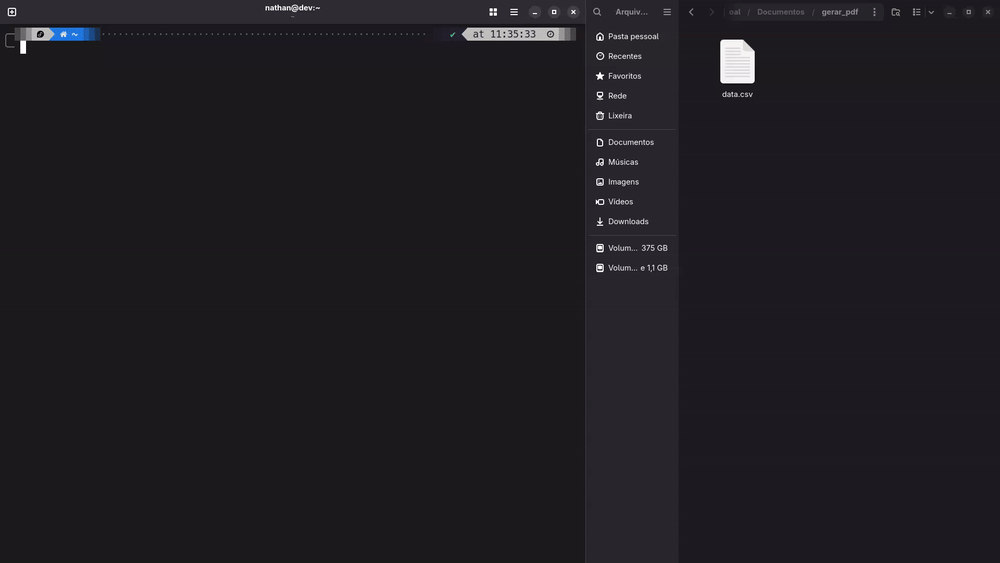
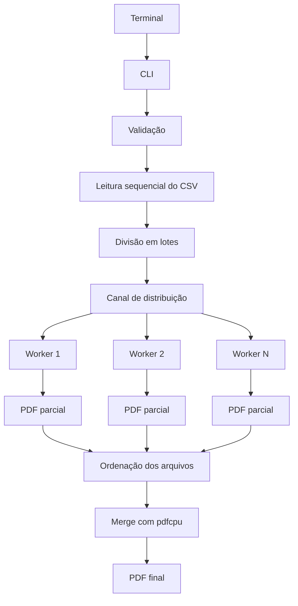

O PDFGen é uma ferramenta de linha de comando desenvolvida em Go para gerar documentos PDF a partir de arquivos CSV e unir múltiplos documentos em um único arquivo.

A aplicação combina leitura incremental de dados, processamento concorrente e geração de documentos paginados. Com isso, é possível transformar grandes conjuntos de registros em relatórios estruturados e também consolidar diferentes PDFs por meio de um único comando.

## O problema

Arquivos CSV são frequentemente utilizados para armazenar e transportar dados estruturados. Entretanto, quando essas informações precisam ser apresentadas em formato documental, surgem desafios relacionados à organização das colunas, distribuição dos registros entre páginas e legibilidade das tabelas.

O volume de dados também influencia diretamente o processamento. Uma abordagem que carrega todo o conteúdo simultaneamente em memória pode se tornar um problema conforme o tamanho dos arquivos aumenta.

Além da geração, outro cenário comum é a necessidade de consolidar relatórios produzidos separadamente. Fazer essa união manualmente adiciona uma etapa ao fluxo de trabalho.

O PDFGen surgiu para reunir essas operações em uma ferramenta executada diretamente pelo terminal.

## A solução

A aplicação possui dois comandos principais: `create`, responsável por gerar PDFs a partir de arquivos CSV, e `merge`, utilizado para unir documentos PDF existentes.

Na geração, os registros são lidos incrementalmente e distribuídos entre múltiplas goroutines. Cada worker constrói seu próprio documento parcial, evitando o compartilhamento de estruturas que não são seguras para acesso concorrente. Ao final, os arquivos parciais são unidos na ordem original dos registros.

O resultado é um documento A4 com tabelas paginadas, cabeçalhos repetidos, linhas alternadas e suporte a imagens de papel timbrado.

## Demonstração



## Funcionalidades

A geração utiliza arquivos CSV com separador `;`, identifica o cabeçalho e distribui automaticamente a largura disponível entre as colunas. A leitura também considera arquivos com BOM, incluindo codificações UTF-8 e UTF-16.

Os documentos são gerados em formato A4, com paginação automática e repetição do cabeçalho da tabela em cada página. As linhas recebem alternância de fundo para facilitar a leitura, e imagens PNG, JPG ou JPEG podem ser utilizadas como papel timbrado.

O processamento concorrente permite configurar a quantidade de workers e acompanhar o andamento da geração pelo terminal. A aplicação também oferece a união de múltiplos PDFs, preservando a ordem informada na execução.

## Arquitetura

O fluxo de geração foi ampliado para permitir que a leitura dos dados e a construção dos documentos aconteçam em etapas independentes.



A leitura do CSV permanece sequencial, enquanto a renderização dos lotes é distribuída entre os workers. Cada goroutine utiliza sua própria instância de `gofpdf`, pois a estrutura `Fpdf` não é segura para utilização simultânea por múltiplas goroutines.

Depois da geração, os documentos parciais são ordenados pelo índice do lote e unidos com `pdfcpu`. Essa etapa mantém a sequência original dos registros, mesmo que os workers terminem em momentos diferentes.

O comando `merge` utiliza o mesmo mecanismo de união para consolidar PDFs já existentes, sem precisar passar pelo processo de geração a partir de CSV.

## Estrutura do projeto

```text
pdfgen/
├── cmd/
│   └── pdfgen/
│       └── main.go
├── internal/
│   ├── cli/
│   │   ├── command_create.go
│   │   ├── command_merge.go
│   │   └── commando_help.go
│   ├── csv/
│   │   └── reader.go
│   ├── pdf/
│   │   ├── concurrent.go
│   │   ├── document.go
│   │   ├── merge.go
│   │   └── progress.go
│   └── validate/
│       └── validate.go
├── assets/
│   └── demo.gif
├── .github/
│   └── workflows/
│       └── release.yml
├── go.mod
├── go.sum
├── install.sh
└── README.md
```

## Processamento concorrente

A geração paralela utiliza uma estratégia de *Worker Pool* com divisão dos registros em lotes. O tamanho padrão de cada lote é de 3.000 registros.

Uma goroutine realiza a leitura sequencial do CSV e envia os lotes por meio de um canal. Os workers recebem esses dados e constroem documentos PDF independentes, que são gravados temporariamente em disco.

Essa abordagem permite aproveitar múltiplos núcleos do processador durante a renderização, sem compartilhar uma mesma instância de `gofpdf` entre goroutines.

A quantidade de workers pode ser configurada pelo usuário. Quando não informada, a aplicação utiliza a quantidade de núcleos disponíveis na máquina.

```bash
pdfgen create -file dados.csv -o relatorio.pdf -workers 4
```

Após a conclusão dos lotes, os arquivos temporários são ordenados e unidos em um único documento. O diretório temporário é removido ao final da execução.

## Acompanhamento do processamento

A aplicação também disponibiliza um mecanismo de acompanhamento da geração. Quando habilitado, o terminal apresenta a quantidade de registros processados, o percentual de conclusão, a taxa de processamento e uma estimativa de tempo restante.

Para calcular o percentual, o CSV é percorrido previamente para contar os registros utilizando o mesmo parser e mecanismo de decodificação empregados na geração. Essa contagem permite apresentar uma estimativa baseada no total real de registros, em vez de depender da quantidade de linhas físicas do arquivo.

O acompanhamento pode ser desativado com `-progress=false`.

## União de documentos PDF

Além da geração, o PDFGen possui o comando `merge`, que permite consolidar diferentes arquivos PDF em um único documento.

A operação utiliza a biblioteca `pdfcpu` e aceita os arquivos como argumentos posicionais ou por meio do parâmetro `-files`.

```bash
pdfgen merge -o final.pdf janeiro.pdf fevereiro.pdf marco.pdf
```

Também é possível utilizar padrões de arquivos reconhecidos pelo shell:

```bash
pdfgen merge -o final.pdf partes/*.pdf
```

Ou informar os caminhos em uma lista separada por vírgulas:

```bash
pdfgen merge -o final.pdf -files janeiro.pdf,fevereiro.pdf,marco.pdf
```

A ordem dos arquivos informados é preservada no documento final. A operação exige pelo menos dois PDFs.

## Configuração da página

| Propriedade | Valor |
|---|---:|
| Formato | A4 |
| Largura | 210 mm |
| Altura | 297 mm |
| Margem superior | 55 mm |
| Margem inferior | 35 mm |
| Margem esquerda | 10 mm |
| Margem direita | 10 mm |
| Área útil horizontal | 190 mm |

A largura disponível é distribuída igualmente entre as colunas identificadas no cabeçalho do CSV. Quando uma célula possui conteúdo maior que o espaço disponível, o texto é distribuído em múltiplas linhas, considerando a altura necessária para a linha inteira.

## Formato dos dados

O formato esperado utiliza ponto e vírgula como separador, sendo a primeira linha reservada para identificar as colunas.

```csv
timestamp;ip;method;path;status;response_time_ms;user_agent;user
2026-09-03 08:15:32;192.168.1.10;GET;/api/users;200;42;Mozilla/5.0;admin
2026-09-03 08:16:04;192.168.1.25;POST;/api/login;401;18;Mozilla/5.0;-
2026-09-03 08:17:21;192.168.1.10;GET;/api/reports;200;137;Chrome/140;joao
2026-09-03 08:18:45;10.0.0.15;GET;/api/users/42;404;23;Firefox/142;maria
```

Esse formato permite utilizar a ferramenta com diferentes conjuntos de dados, incluindo registros de acesso HTTP, relatórios administrativos e informações tabulares exportadas por outros sistemas.

## Decisões técnicas

A escolha de Go permite desenvolver uma aplicação compilada, com suporte nativo a goroutines e canais para organizar o processamento concorrente.

Um ponto importante da implementação é o isolamento dos documentos gerados por cada worker. Como `gofpdf.Fpdf` não é thread-safe, cada worker possui sua própria instância para renderizar os registros de maneira independente. A consolidação acontece somente depois que os documentos parciais são finalizados.

A utilização de arquivos temporários evita manter todos os documentos parciais em memória durante a execução. A ordenação pelo índice dos lotes garante que a concorrência não altere a sequência dos dados no PDF final.

A biblioteca `gofpdf` é responsável pela construção dos documentos, enquanto `pdfcpu` realiza a união dos arquivos. A biblioteca `golang.org/x/text` auxilia na leitura de CSVs com diferentes marcas de codificação.

## Tecnologias

| Tecnologia | Aplicação |
|---|---|
| Go | Linguagem principal e concorrência |
| gofpdf | Geração dos documentos PDF |
| pdfcpu | União de documentos PDF |
| encoding/csv | Leitura e interpretação dos registros |
| golang.org/x/text | Decodificação de arquivos com BOM |
| Shell | Automação da instalação |

## Utilização

O PDFGen disponibiliza dois comandos principais.

**Gerar PDF a partir de CSV:**

```bash
pdfgen create -file <arquivo.csv> -o <saida.pdf> [-c <timbre.png>]
```

O parâmetro `-file` informa o arquivo CSV de entrada, enquanto `-o` define o caminho do documento PDF gerado. O parâmetro opcional `-c` recebe a imagem utilizada como papel timbrado.

**Configurar a quantidade de workers:**

```bash
pdfgen create -file dados.csv -o relatorio.pdf -workers 4
```

**Desativar o acompanhamento do progresso:**

```bash
pdfgen create -file dados.csv -o relatorio.pdf -progress=false
```

**Unir documentos:**

```bash
pdfgen merge -o final.pdf arquivo1.pdf arquivo2.pdf
```

**Consultar a ajuda:**

```bash
pdfgen help
pdfgen --help
```

## Validação

Antes de iniciar a geração, os parâmetros são verificados para evitar operações com arquivos inválidos.

O arquivo de entrada deve existir, não pode ser um diretório e precisa possuir a extensão `.csv`. O destino deve possuir a extensão `.pdf` e seu diretório pai precisa existir. Quando uma imagem de papel timbrado é informada, também são verificadas sua existência e extensão, aceitando PNG, JPG e JPEG.

Na operação de união, a aplicação verifica se foram informados pelo menos dois arquivos e se os documentos de entrada podem ser acessados.

## Instalação

A instalação pode ser realizada diretamente pelo script disponibilizado no repositório.

```bash
curl -fsSL https://raw.githubusercontent.com/Nathan-rs/pdfgen/main/install.sh | sh
```

Após a instalação, o executável pode ser verificado utilizando:

```bash
pdfgen --help
```

Também é possível compilar a aplicação a partir do código-fonte:

```bash
git clone https://github.com/Nathan-rs/pdfgen.git
cd pdfgen
go build -o pdfgen ./cmd/pdfgen
```

Para executar diretamente com Go:

```bash
go run ./cmd/pdfgen create -file dados.csv -o relatorio.pdf
```

O projeto declara Go 1.26.0 no `go.mod`. O workflow de release disponibilizado no repositório está configurado para gerar binários Linux nas arquiteturas AMD64 e ARM64.

## Evolução

A implementação atual já contempla geração concorrente, união de documentos e acompanhamento do processamento. Essas melhorias ampliam o uso da ferramenta, permitindo tanto a criação de relatórios a partir de grandes conjuntos de dados quanto a consolidação de documentos produzidos em etapas diferentes.

Ainda existem oportunidades de evolução, como a implementação de um leitor CSV dedicado, logging estruturado, testes unitários e de integração, inserção de capas e otimização dos documentos gerados.

Também podem ser exploradas melhorias na estratégia de processamento, especialmente na escolha do tamanho dos lotes e na quantidade de workers, utilizando benchmarks para avaliar o comportamento com diferentes volumes de dados.

## Considerações finais

O PDFGen começou como uma ferramenta para converter arquivos CSV em documentos PDF e evoluiu para uma aplicação capaz de processar dados concorrentemente e consolidar documentos.

O projeto explora aspectos importantes do desenvolvimento em Go, como manipulação de arquivos, processamento incremental, goroutines, canais, sincronização e integração com bibliotecas externas.

A combinação de geração paralela com a união dos documentos parciais permite estruturar um fluxo de processamento que busca aproveitar melhor os recursos disponíveis, mantendo a ordem dos registros no resultado final.

## Repositório

O código-fonte e as instruções de utilização estão disponíveis no GitHub:

[github.com/Nathan-rs/pdfgen](https://github.com/Nathan-rs/pdfgen)

## Licença

Este projeto é de uso interno. Para informações sobre licenciamento e utilização, consulte o autor.