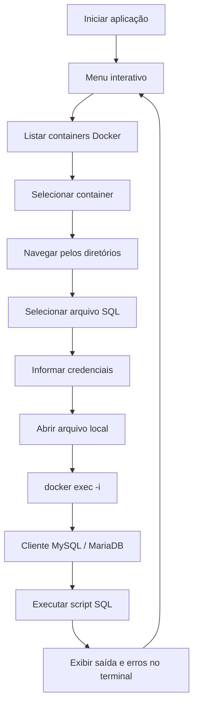

O Import SQL é uma aplicação de linha de comando desenvolvida em Go para facilitar a execução de arquivos SQL em bancos de dados MySQL e MariaDB executados dentro de containers Docker.

A ferramenta oferece uma interface interativa no terminal para selecionar o container, navegar pelos diretórios locais, escolher um arquivo `.sql` e informar as credenciais do banco de dados.

A execução acontece diretamente no container selecionado, sem a necessidade de copiar previamente o arquivo para dentro dele.

## O problema

Em ambientes de desenvolvimento que utilizam Docker, é comum manter bancos de dados em containers e armazenar scripts SQL no sistema de arquivos local.

Para executar esses scripts manualmente, normalmente é necessário identificar o container correto, preparar o comando `docker exec`, informar as credenciais e redirecionar o conteúdo do arquivo para o cliente do banco de dados.

Esse processo pode se tornar repetitivo, principalmente quando é necessário alternar entre diferentes containers e arquivos SQL.

O Import SQL surgiu para simplificar esse fluxo, reunindo a seleção do container, a escolha do arquivo e a execução do script em uma única interface.

## A solução

A aplicação utiliza uma interface interativa baseada na biblioteca `survey`, permitindo realizar as operações diretamente pelo terminal.

Primeiro, os containers Docker em execução são listados para que o usuário selecione o ambiente desejado. Em seguida, um navegador de arquivos permite percorrer os diretórios locais e selecionar um arquivo com extensão `.sql`.

Depois da seleção, a aplicação solicita o usuário, a senha e o nome do banco de dados. Com essas informações, o arquivo é aberto localmente e seu conteúdo é transmitido diretamente para o cliente MySQL executado dentro do container.

Esse fluxo evita a necessidade de utilizar comandos manuais para cada etapa e mantém o arquivo SQL no ambiente local.

## Fluxo de execução



O fluxo é organizado para que a seleção do container seja reutilizada durante a sessão. Caso o usuário escolha trocar de ambiente, a seleção armazenada é reiniciada e um novo container pode ser escolhido.

## Interface interativa

A interface apresenta um menu principal com as opções de execução de scripts SQL, troca de container e encerramento da aplicação.

A seleção é realizada por meio de menus navegáveis, sem exigir que o usuário memorize nomes de containers ou caminhos completos dos arquivos.

O navegador de arquivos permite entrar em diretórios, retornar ao diretório anterior e selecionar arquivos `.sql`. Arquivos ocultos não são exibidos, e diretórios são identificados visualmente para facilitar a navegação.

As credenciais são solicitadas somente depois da seleção do arquivo. O campo de senha utiliza o componente de entrada protegida da biblioteca `survey`.

## Execução dos scripts

Um dos principais aspectos técnicos do projeto é a maneira como o arquivo SQL é enviado ao container.

Em vez de copiar o arquivo com `docker cp`, a aplicação abre o arquivo localmente e o associa à entrada padrão do processo executado pelo Docker.

```go
cmd := exec.CommandContext(ctx,
    "docker", "exec", "-i", containerName,
    "mysql", "--force", "-u"+user, "-p"+password, database,
)

file, err := os.Open(filePath)
if err != nil {
    return fmt.Errorf("erro ao abrir arquivo: %v", err)
}
defer file.Close()

cmd.Stdin = file
cmd.Stdout = os.Stdout
cmd.Stderr = os.Stderr
```

A opção `-i` do `docker exec` mantém a entrada padrão disponível para o processo dentro do container. Dessa forma, o conteúdo do arquivo é transmitido diretamente ao cliente MySQL.

A saída padrão e a saída de erro são conectadas ao terminal, permitindo acompanhar as mensagens produzidas durante a execução.

O comando também utiliza `--force`, que permite ao cliente MySQL continuar a execução mesmo quando encontra erros em instruções SQL.

Para evitar que uma operação fique executando indefinidamente, o processo possui um limite de tempo de 60 minutos por execução.

## Arquitetura

O projeto utiliza uma estrutura modular em Go, separando a interface interativa, a navegação de arquivos, a coleta de credenciais e a comunicação com os containers.

```text
import_sql/
├── cmd/
│   └── main.go
├── internal/
│   ├── container/
│   │   ├── exec.go
│   │   └── manager.go
│   ├── file/
│   │   └── browser.go
│   ├── prompt/
│   │   └── input.go
│   └── ui/
│       └── menu.go
├── docker-compose.yml
├── go.mod
├── go.sum
├── context.md
├── README.md
└── TODO.txt
```

O ponto de entrada inicia a interface principal, que coordena as etapas necessárias para a execução. A comunicação com o Docker é realizada por meio de comandos externos, utilizando o pacote `os/exec` da biblioteca padrão do Go.

Essa abordagem mantém a aplicação simples, sem exigir uma biblioteca específica para comunicação com a API do Docker.

## Decisões técnicas

A escolha de Go permite desenvolver uma aplicação compilada e utilizar recursos da biblioteca padrão para executar processos externos, manipular arquivos e controlar o tempo de execução.

A biblioteca `survey` foi escolhida para construir a experiência interativa no terminal, oferecendo componentes de seleção, entrada de texto e campos protegidos por senha.

A utilização de `docker exec -i` com `stdin` permite transmitir arquivos SQL sem criar uma cópia dentro do container. Além de reduzir etapas, essa abordagem evita depender de um diretório temporário no ambiente do banco de dados.

O uso de `context.WithTimeout` adiciona um limite de execução ao processo, enquanto a conexão direta de `stdout` e `stderr` ao terminal permite acompanhar as mensagens do cliente MySQL.

## Tecnologias

| Tecnologia | Aplicação |
|---|---|
| Go | Linguagem principal |
| Docker CLI | Comunicação com os containers |
| MySQL / MariaDB | Execução dos scripts SQL |
| Survey | Interface interativa no terminal |
| os/exec | Execução de comandos externos |
| context | Controle do tempo de execução |

## Pré-requisitos

Para utilizar a aplicação, é necessário possuir Docker instalado e em execução, além de pelo menos um container com MySQL ou MariaDB disponível.

O comando `docker` precisa estar acessível no ambiente em que a aplicação será executada, com permissões suficientes para listar e executar comandos nos containers.

Também é necessário possuir as credenciais de acesso ao banco de dados e um arquivo SQL local para executar.

## Utilização

Primeiro, baixe as dependências definidas no projeto:

```bash
go mod download
```

Em seguida, execute a aplicação:

```bash
go run ./cmd
```

O menu interativo será apresentado no terminal. Após selecionar a opção de execução, basta escolher o container, navegar até o arquivo SQL e informar as credenciais do banco de dados.

Para compilar um executável:

```bash
go build -o import_sql ./cmd
```

Depois da compilação, a aplicação pode ser iniciada com:

```bash
./import_sql
```

## Ambiente Docker

O projeto também disponibiliza um arquivo `docker-compose.yml` para preparar um ambiente de desenvolvimento com Go.

A configuração utiliza a imagem `golang:1.25`, monta o diretório do projeto em `/app` e mantém o terminal interativo disponível.

```bash
docker compose up -d
```

Para executar a aplicação nesse ambiente, é necessário que o container tenha acesso ao Docker CLI e ao daemon Docker do host. A configuração atual do Compose não monta automaticamente o socket do Docker, portanto esse acesso precisa ser preparado para que os comandos de gerenciamento de containers funcionem.

## Evolução

O projeto estabelece uma base para automatizar tarefas recorrentes de execução de scripts SQL em ambientes Docker.

Entre as possibilidades de evolução estão a implementação de um histórico de execuções, identificação automática do tipo de banco de dados, seleção de múltiplos arquivos e acompanhamento mais detalhado dos resultados.

Também podem ser adicionadas operações para importar arquivos para o container e removê-los posteriormente, além de mecanismos de validação das credenciais e dos bancos disponíveis antes da execução.

Outro ponto importante é aprimorar o tratamento de erros SQL, distinguindo falhas na execução do comando Docker de erros retornados pelo próprio banco de dados.

## Considerações finais

O Import SQL simplifica uma tarefa comum em ambientes de desenvolvimento que utilizam Docker: executar scripts SQL em diferentes containers sem depender de comandos manuais repetitivos.

O projeto explora recursos importantes do Go, como execução de processos externos, manipulação de arquivos, entrada e saída de dados, controle de contexto e construção de interfaces interativas no terminal.

A comunicação por meio de `stdin` é um dos principais aspectos da implementação, permitindo executar arquivos locais diretamente no banco de dados dentro do container, sem precisar transferi-los previamente.

## Repositório

O código-fonte e as instruções de utilização estão disponíveis no GitHub:

[github.com/Nathan-rs/import_sql](https://github.com/Nathan-rs/import_sql)